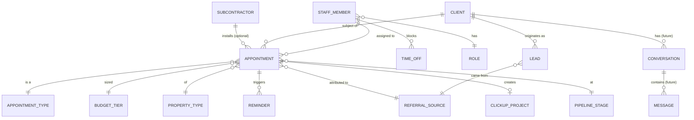

# 05 · Data Model — objects & relationships

Tags: **[C1]** May · **[C2]** June 11 · **[C3]** June 22.

## Object-relationship hierarchy (as framed in the request)

```
PEOPLE
├── Internal
│   ├── Admin
│   │   └── Owner ............ Tanya Koyle — full access + edits config fields  [C2]
│   └── Users (staff)
│       ├── Nissa ........... admin / booking
│       ├── Carolyn ......... sales
│       ├── Tracy ........... sales / flex
│       └── Student assistant (Assistant / limited)
│           └── USER LEVELS: Owner-Admin · Staff · Assistant   (see doc 06)
└── External
    ├── Clients ............. the customers (homeowners / builders)  [C3]
    ├── Subcontractors ...... external installers  [C2]
    └── Leads/Inquiries ..... not-yet-booked prospects (source-tagged)  [C3]

EVENTS
├── Appointments ........... typed, assigned, on the one shared team calendar  [C3]
└── Time-off blocks ........ per-staff "Unavailable" ranges  [C3]
```

- **No role-based calendar differentiation** — every internal user sees every appointment and any
  user can be assigned any appointment type [C3].
- **People ↔ Events**: a `StaffMember` (internal) is *assigned to* Appointments; a `Client`
  (external) is *the subject of* Appointments. Time-off belongs to a StaffMember.

## Entity–relationship diagram



## Entities & fields

Legend: 🔑 primary key · → foreign key · ● required.

### StaffMember (internal user) [C2][C3]
| Field | Type | Notes |
|-------|------|-------|
| id 🔑 | uuid | |
| full_name ● | text | |
| email ● | text | login + notifications |
| phone ● | text | for text notifications [C3] |
| color | text | calendar color dot |
| role → ● | enum | `owner` / `staff` / `assistant` (see doc 06) |
| google_calendar_connected | bool | sync status [C3] |
| active | bool | offboarding |

### Role (user level) [C2][C3]
| Field | Type | Notes |
|-------|------|-------|
| key 🔑 | enum | `owner`, `staff`, `assistant` |
| can_edit_config | bool | owner only — true for `owner` [C2] |
| label | text | display |

### Client (external customer) [C3]
| Field | Type | Notes |
|-------|------|-------|
| id 🔑 | uuid | |
| name ● | text | |
| phone | text | tap-to-text; PII |
| email | text | tap-to-email; PII |
| address | text | in-home service location |
| default_referral_source → | fk | how they found the business |
| notes | text | |
| created_at | timestamptz | |

### Appointment (Event) [C3]
| Field | Type | Notes |
|-------|------|-------|
| id 🔑 | uuid | |
| client_id → ● | fk Client | |
| assigned_staff_id → ● | fk StaffMember | any staff, no type restriction [C3] |
| type_id → ● | fk AppointmentType | drives color |
| title | text | e.g., "Consult · Hendricks" |
| start ● | timestamptz | |
| end ● | timestamptz | |
| address | text | can differ from client default |
| budget_tier → | fk BudgetTier | `<2k/2–5k/5–10k/10k+` [C3] |
| property_type → | fk PropertyType | [C2][C3] |
| referral_source → | fk ReferralSource | attribution |
| status | enum | scheduled/confirmed/completed/rescheduled/cancelled |
| notes | text | |
| pipeline_stage → | fk PipelineStage | inquiry/consult/quote/won |
| quote_sent | bool | manual flag (no quoting engine) [C1][C2] |
| quote_amount | numeric | feeds Avg Quote |
| won | bool | feeds Won Value |
| clickup_project_id | text | link created on booking [C2] |
| created_by → | fk StaffMember | audit [C1] |
| created_at | timestamptz | |

> **Double-booking rule:** no two `Appointment`s for the same `assigned_staff_id` may overlap in
> `[start,end)` (FR-058) [C3].

### AppointmentType (config, owner-editable) [C3]
| Field | Type | Notes |
|-------|------|-------|
| id 🔑 | uuid | |
| name ● | text | Initial Consult, Install Walkthrough, Design Review, Site Visit, Final Reveal, Networking… |
| color ● | text | calendar color |
| self_bookable | bool | future self-booking opt-in per type [C1][C2] |

### ReferralSource (config, owner-editable) [C3]
| Field | Type | Notes |
|-------|------|-------|
| id 🔑 | uuid | |
| name ● | text | Website, Referral, Instagram, **Facebook (added)**, Google, Houzz, Repeat client — **"House" removed** [C3] |
| active | bool | |

### BudgetTier (config) [C3]
| Field | Type | Notes |
|-------|------|-------|
| id 🔑 | uuid | |
| label ● | text | `Under $2k`, `$2–5k`, `$5–10k`, `$10k+` |
| min / max | numeric | bounds |

### PropertyType (config) [C2][C3]
| Field | Type | Notes |
|-------|------|-------|
| id 🔑 | uuid | |
| name ● | text | e.g., Residential / New build / Commercial — **final list TBD (doc 07)** |

### Lead / Inquiry [C3]
| Field | Type | Notes |
|-------|------|-------|
| id 🔑 | uuid | |
| client_id → | fk Client | may be a fresh prospect |
| source → ● | fk ReferralSource | |
| city | text | shown in falling-through list |
| budget_tier → | fk BudgetTier | |
| last_contact_at | timestamptz | drives **days-since-contact** [C3] |
| status | enum | new / contacted / booked / lost |
| created_at | timestamptz | |

> "Falling through the cracks" = Leads/Clients with no active/booked consult and stale
> `last_contact_at` [C3]. **Open question (doc 07):** how do un-booked inquiries enter — manual,
> lead-form webhook, or the future unified inbox? Currently the demo is calendar-driven.

### TimeOff [C3]
| Field | Type | Notes |
|-------|------|-------|
| id 🔑 | uuid | |
| staff_id → ● | fk StaffMember | |
| start ● / end ● | timestamptz | full day/week supported |
| reason | enum/text | Vacation / Personal |
| → renders as | "Unavailable — reason"; hides personal detail [C3] |

### Reminder / Notification [C2]
| Field | Type | Notes |
|-------|------|-------|
| id 🔑 | uuid | |
| appointment_id → ● | fk Appointment | |
| channel ● | enum | `sms` / `email` |
| kind | enum | confirmation / reminder |
| send_at | timestamptz | reminder lead time |
| status | enum | pending/sent/failed |
| template | text | owner-configurable wording [C2] |

### PipelineStage [C2][C3]
| Field | Type | Notes |
|-------|------|-------|
| key 🔑 | enum | `inquiry` → `consult_booked` → `quote_sent` → `won` |
| order | int | funnel order |

### Subcontractor (external installer) [C2]
| Field | Type | Notes |
|-------|------|-------|
| id 🔑 | uuid | |
| name ● | text | |
| trade | text | install |
| contact | text | |

### ClickUpProject link [C2]
| Field | Type | Notes |
|-------|------|-------|
| appointment_id → 🔑 | fk Appointment | one project per booking |
| clickup_task_id | text | |
| url | text | |
| created_at | timestamptz | |

### (Future) Conversation / Message — unified inbox [C2][C3]
| Field | Type | Notes |
|-------|------|-------|
| Conversation.id 🔑 | uuid | per client |
| Conversation.client_id → | fk Client | |
| Message.channel | enum | facebook / instagram / email / sms |
| Message.direction | enum | in / out |
| Message.body | text | full correspondence history in one place |
| Message.sent_at | timestamptz | |

## Config vs. transactional
- **Config (owner-editable only [C2]):** Role, AppointmentType, ReferralSource, BudgetTier,
  PropertyType, StaffMember, PipelineStage.
- **Transactional (all internal users):** Client, Appointment, Lead, TimeOff (own), Reminder,
  ClickUpProject.
